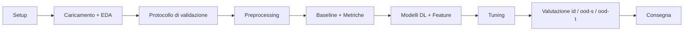

# Briefing di progetto — *Forecasting vegetation health from satellite time series*

**Fonte:** [DL_Project.pdf](file:///c:/Users/Daniele/Desktop/Progetto%20Deep%20Learning/DeepLearning2026/DL_Project.pdf) (7 slide).

> [!NOTE]
> Il briefing si basa **solo sul PDF**. In alcuni punti il [README dei dati](file:///c:/Users/Daniele/Desktop/Progetto%20Deep%20Learning/DeepLearning2026/DATA/README.md) dà dettagli in più. Quando li uso, li segno con 📎 **README** per non confonderli con il contenuto delle slide.

---

## 1. Contesto e obiettivo del progetto

### Problema e dominio
- **Dominio:** telerilevamento e agricoltura. Si monitora la **salute della vegetazione nelle colture** con immagini satellitari **Sentinel-2**.
- **Problema:** è un **forecasting probabilistico multivariato e multi-step** su serie temporali **a campionamento irregolare**.
  - Si parte da **3 osservazioni passate** senza nubi (*clear-sky*) e dal **meteo giornaliero** (passato e futuro).
  - Si prevedono le **prossime 3 acquisizioni clear-sky** (circa **14 giorni** in avanti).
  - I target sono **3 indici di vegetazione**.
- **Schema I/O (slide 2):** `History + weather → Your model → 3 indici × 3 step futuri`.

### I tre indici target (slide 2)

| Indice | Formula | Significato |
|---|---|---|
| **NDVI** | $\frac{NIR - Red}{NIR + Red}$ | Verde della chioma. È l'indicatore standard della vegetazione. |
| **GNDVI** | $\frac{NIR - Green}{NIR + Green}$ | Più sensibile al **contenuto di clorofilla**. |
| **EVI** | $2.5 \cdot \frac{NIR - Red}{NIR + 6\,Red - 7.5\,Blue + 1}$ | **Satura meno** sulla vegetazione densa. |

**Come funzionano:** la vegetazione sana riflette molto nel vicino infrarosso (NIR) e assorbe nel rosso. Quindi più la vegetazione è sana, più NDVI e GNDVI salgono (il loro intervallo è [-1, 1]). L'EVI ha due correzioni:
- usa la banda blu per ridurre l'effetto dell'atmosfera;
- ha un termine di correzione del suolo, così satura meno dove l'NDVI resta schiacciato vicino a 1.

### Deliverable principali (slide 5 e 7)
1. **Un modello** che per ogni indice e ogni step futuro restituisce i **quantili 0.1, 0.5 e 0.9**. In totale sono **3 × 3 × 3 = 27 valori per finestra**.
2. **Un repository di codice** pulito, commentato ed **eseguibile da capo a fondo**, con:
   - `README.md`: setup, come addestrare, come valutare, risultati;
   - `requirements.txt` con **versioni fissate (pinned)**.
3. **Le slide** in formato **`.pptx`**, le stesse usate nella presentazione.
4. **Una presentazione orale** di **12 minuti esatti**, seguita da domande.

---

## 2. Analisi del dataset

### Origine e struttura (slide 3 e 5)

| Aspetto | Dettaglio |
|---|---|
| **Sorgente** | Minicubi **GreenEarthNet**, da **Sentinel-2** |
| **Risoluzione dei minicubi** | 128 × 128 px a 20 m (circa 2.56 km di lato) |
| **Bande** | Blue, Green, Red, NIR |
| **Periodo** | 2017–2022 |
| **Copertura** | Europa, dal clima mediterraneo a quello boreale. Dominano frumento, mais e altri cereali |
| **Meteo** | **E-OBS**, giornaliero: vento, umidità, radiazione, pioggia, pressione al livello del mare, statistiche di temperatura |
| **Target** | Indici **mediati sui pixel validi di coltura**. Hanno un valore **solo nelle date senza nubi**, quindi il campionamento è **irregolare** |
| **Finestre** | Già tagliate: **3 passi passati → 3 passi futuri, stride 4** |
| **Feature** | **21**: meteo, nubi, termini di Fourier del giorno dell'anno, NDVI/GNDVI/EVI clear-sky |
| **Formato file** | Non specificato nel documento. 📎 **README:** un file `<area>.npz` (dati grezzi) e un `<area>.json` (nomi delle feature, date, classe climatica di Köppen) per ogni area, più `scaler.json` |

### Split (slide 4)

| Split | Dove | Quando | Campioni | Uso consentito |
|---|---|---|---|---|
| **train** | Regioni di training | 2017–2019 | **55,338** | Addestramento e **selezione degli iperparametri** (su un sotto-insieme di validazione ricavato dal train) |
| **id** | Vicino alle località di training | 2020 | **3,336** | **Solo valutazione** |
| **ood-s** | **Regioni mai viste** | 2017–2019 | **25,619** | **Solo valutazione** (spostamento spaziale) |
| **ood-t** | Stesse località di *id* | **2021–2022** | **6,512** | **Solo valutazione** (spostamento temporale) |
| **hidden test** | — | — | — | Lo tengono i docenti e non viene mai rilasciato. Serve per la **valutazione finale** |

📎 **README e cartelle:** `train_multi_output_clear_sky/` corrisponde al train, `val_chopped_…` a **id**, `ood-s_chopped_…` e `ood-t_chopped_…` agli altri due split.

### Variabile target
Il target è **multi-output**: **NDVI, GNDVI ed EVI** per i **3 step futuri**. Va previsto in forma **probabilistica**, con i quantili 0.1, 0.5 e 0.9.

### Criticità che emergono dalle slide
- **Campionamento irregolare:** i 3 step futuri sono "le prossime 3 acquisizioni clear-sky". La distanza in giorni tra uno step e l'altro cambia da finestra a finestra. "≈ 14 giorni" è solo un valore medio.
- **Dati mancanti:** i buchi sono lasciati **a NaN, con maschere, senza interpolazione**. Bisogna gestirli con il masking o con modelli che accettano i NaN.
- **Meteo futuro rumoroso:** al meteo futuro è già stato **aggiunto rumore**, come in una vera previsione meteo. Il modello non deve fidarsi troppo di questi valori.
- **Normalizzazione:** `scaler.json` è **calcolato sul train ma non applicato**. I dati sono in scala originale.
  - Lo scaler proposto fa una standardizzazione e poi applica **arcsinh**:
    $$z = \frac{x - \mu}{\sqrt{\sigma^2 + 10^{-5}}}, \quad y = \operatorname{arcsinh}(z)$$
  - L'arcsinh comprime le code delle distribuzioni asimmetriche, come pioggia e frazioni di nubi. L'inversa è $x = \sinh(y)\sqrt{\sigma^2+10^{-5}} + \mu$. La formula esatta e l'inversa vengono dal 📎 **README**: la slide dice solo "mean, variance, arcsinh".
- **Distribution shift:** il criterio decisivo è la **generalizzazione a regioni e anni mai visti** (ood-s e ood-t). In più c'è grande varietà climatica, dal Mediterraneo al boreale.
- **Squilibrio tra split:** ood-s (25.6k campioni) è molto più grande di id (3.3k). Le slide non parlano di sbilanciamento delle classi, perché è un problema di regressione.

---

## 3. Requisiti, vincoli e criteri di valutazione

### Vincoli fissi, uguali per ogni gruppo (slide 5)
- Si prevedono **tutti e tre** i target: NDVI, GNDVI, EVI.
- Finestre: **3 passi passati → 3 step clear-sky futuri**.
- Si addestra **solo sullo split train**. id, ood-s e ood-t servono **solo per la valutazione**.
- Gli iperparametri si scelgono su una **validazione ricavata dal train**.
- Output: **quantili 0.1 / 0.5 / 0.9** per ogni indice e ogni step.

### Scelte libere (slide 5)

| Aspetto | Opzioni indicate |
|---|---|
| Normalizzazione | Lo scaler fornito (mean, var, arcsinh) oppure uno proprio |
| Valori mancanti | Masking, oppure modelli che gestiscono i NaN |
| Feature | Selezione, embedding, feature derivate |
| Architettura | Statistica, ricorrente, convoluzionale, transformer, foundation model, … |
| Loss e training | **Qualsiasi obiettivo che produca i tre quantili** (ad esempio la pinball loss) |

- **Tecnologie e librerie obbligatorie:** non specificato nel documento. È richiesto solo un `requirements.txt` con versioni fissate, il che fa pensare a Python.

### Metriche di valutazione (slide 6)
Il confronto è con un **modello di riferimento dei docenti**. Si usano gli stessi split e lo stesso orizzonte, e le **metriche si calcolano sulla scala originale degli indici**, quindi le previsioni vanno riportate indietro dalla normalizzazione.

**Accuratezza puntuale**, calcolata sulla mediana (q = 0.5), **per ogni indice e ogni split**:
- **RMSE** $=\sqrt{\frac{1}{n}\sum (y-\hat y)^2}$. Penalizza di più gli errori grandi.
- **MAE** $=\frac{1}{n}\sum |y-\hat y|$. È l'errore assoluto medio.
- **WMAPE** $=\frac{\sum |y-\hat y|}{\sum |y|}$. È l'errore percentuale pesato, e resta stabile anche quando i valori sono vicini a 0.
- **MASE**: è il MAE diviso per il MAE di un **baseline naïve**. Un valore < 1 vuol dire che il modello batte il baseline. Il documento non dice quale baseline si usa.

**Incertezza**, calcolata sui quantili 0.1, 0.5 e 0.9:
- **Pinball loss** del quantile $q$: $L_q(y,\hat y_q) = \max\big(q(y-\hat y_q),\,(q-1)(y-\hat y_q)\big)$. Punisce in modo asimmetrico le sovrastime e le sottostime.
- **CRPS**: misura quanto la distribuzione prevista è distante dal valore osservato. Con pochi quantili si approssima di solito con la media delle pinball loss. Il metodo esatto non è specificato nel documento.
- **Coverage**: la frazione di valori osservati che cade nell'intervallo [q0.1, q0.9]. Se il modello è ben calibrato, è circa **80%**.

### Regole d'esame (slide 7)
- Il progetto vale il **25% del voto finale**.
- Presentazione di **12 minuti esatti** più domande.
- **Stessi gruppi** della presentazione del paper.
- **Scadenza: da annunciare**, non è ancora fissata.

---

## 4. Piano operativo step-by-step

| # | Fase | Cosa fare | Perché serve | Output atteso |
|---|---|---|---|---|
| **0** | **Setup** | Creare repo e ambiente Python. Fissare il seed. Creare la struttura `src/`, `notebooks/`, `configs/`. Scrivere subito `requirements.txt` con versioni fissate | Il codice deve essere eseguibile da capo a fondo e riproducibile (slide 7) | Repo con scheletro, ambiente funzionante |
| **1** | **Caricamento e verifica dei dati** | Scrivere un loader per tutti gli split. Controllare che le dimensioni siano (finestre × passi × 21 feature) e (finestre × 3 × 3 target). Controllare che il numero di campioni coincida con le slide (55,338 / 3,336 / 25,619 / 6,512) | Capire con esattezza il formato e scoprire subito eventuali incongruenze | Modulo `data.py` e report di verifica |
| **2** | **Analisi esplorativa (EDA)** | Distribuzioni di feature e target. Percentuale di NaN e struttura delle maschere. Intervalli irregolari tra le date. Stagionalità degli indici. Differenze tra split e tra climi di Köppen. Correlazioni meteo–indici | Guida il preprocessing. Misura lo shift tra train, ood-s e ood-t, che è il criterio principale | Notebook EDA con grafici e insight per la presentazione |
| **3** | **Protocollo di validazione** | Ricavare dal train una validazione **disgiunta per area** (raggruppando per tile) e, se possibile, **per anno** (ad esempio validare sul 2019) | La slide 4 impone di scegliere gli iperparametri sul train. Una validazione per gruppi imita ood-s e ood-t ed evita che informazioni da finestre sovrapposte (stride 4) passino dal train alla validazione | Indici di split fissati e salvati |
| **4** | **Preprocessing** | Normalizzare con lo scaler del train (o uno proprio), **calcolato solo sul train**. Gestire i NaN con valori di riempimento + **maschera come feature di input**. Calcolare le inverse per tornare alla scala originale | I dati arrivano grezzi, con NaN e senza normalizzazione (slide 5). Le metriche si calcolano sulla scala originale (slide 6) | Pipeline `preprocess.py`, testata con un controllo andata-e-ritorno |
| **5** | **Baseline** | (a) Persistenza, cioè ripetere l'ultimo valore osservato. (b) Climatologia per giorno dell'anno. (c) Modello statistico o ad albero con regressione quantile | Dà una base per confrontare i risultati e un riferimento per il MASE | Tabella di metriche delle baseline su id, ood-s, ood-t |
| **6** | **Implementazione delle metriche** | Implementare RMSE, MAE, WMAPE, MASE, pinball, CRPS e coverage, **per indice e per split**, sulla scala originale | È la valutazione esatta che useranno i docenti (slide 6) | `metrics.py` con test unitari |
| **7** | **Modellazione DL** | Provare architetture adatte a sequenze corte con covariate future note, ad esempio GRU/LSTM encoder-decoder, TCN, Transformer leggero o TFT-like. Testa multi-output 3×3×3. Loss = **pinball su 3 quantili**, con un vincolo di monotonia dei quantili | Architettura e loss sono libere, ma i 3 quantili sono obbligatori (slide 5) | Modello addestrato e checkpoint |
| **8** | **Feature engineering e robustezza** | Ripetere su: feature derivate (Δt tra le date, gradi-giorno, pioggia cumulata), embedding (classe Köppen, posizione), regolarizzazione, data augmentation, gestione del meteo futuro rumoroso | Il criterio decisivo è la generalizzazione a regioni e anni mai visti (slide 5) | Studio di ablazione |
| **9** | **Tuning degli iperparametri** | Ricerca sistematica, solo sulla validazione del punto 3 | Regola della slide 4. Evita di sbirciare il test | Configurazione finale fissata |
| **10** | **Valutazione finale** | Una sola valutazione su id, ood-s, ood-t con tutte le metriche, per indice e per split. Controllare la calibrazione (coverage ≈ 80%). Analizzare gli errori per clima e per step | Confronto equo con il modello di riferimento (slide 6) | Tabelle e grafici dei risultati, previsioni con le bande di quantili |
| **11** | **Pronti per il test nascosto** | Scrivere uno script `predict.py` che produce i 27 quantili per finestra a partire da dati grezzi nello stesso formato | Lo split nascosto sarà valutato dai docenti (slide 4) | Script di inferenza documentato |
| **12** | **Consegna** | Pulire e commentare il codice. Scrivere il README (setup / train / evaluate / risultati). Fissare `requirements.txt`. Preparare il `.pptx` e provare la presentazione di **12 minuti** | Deliverable della slide 7 | Repo finale, `.pptx`, prova cronometrata |

---

## 5. Punti aperti e ambiguità

| # | Punto | Nota / assunzione proposta |
|---|---|---|
| 1 | **Scadenza** | "To be announced". Chiedere la data |
| 2 | **Formato di consegna per lo split nascosto** | Non specificato: non si sa se i docenti eseguiranno il nostro codice o se dovremo consegnare previsioni. *Assunzione:* script di inferenza che parte da dati grezzi nello stesso formato |
| 3 | **Definizione del MASE** | Non si sa quale baseline naïve si usa (persistenza? stagionale?) né su quali dati si calcola la scala |
| 4 | **Calcolo del CRPS** | Non è indicato come si approssima a partire da soli 3 quantili |
| 5 | **Valori del modello di riferimento** | Non sappiamo né la sua architettura né le sue metriche. Chiedere se i risultati saranno pubblicati |
| 6 | **Peso dei criteri nel voto** | Non è chiaro quanto contano le metriche rispetto a codice, slide e presentazione orale |
| 7 | **Periodo di ood-t** | La slide dice **2021–2022**, il 📎 README dice **2022**. Da verificare con le date nei JSON |
| 8 | **Ordine e nomi delle 21 feature, maschere** | Nel PDF ci sono solo le categorie. *Assunzione:* li leggiamo dai JSON di ogni area |
| 9 | **Stride 4 e finestre sovrapposte** | Il significato esatto (in osservazioni o in giorni?) non è chiaro. Conta per evitare fughe di informazione tra train e validazione |
| 10 | **Uso di dati o modelli esterni** | Sono citati i foundation model, ma non è detto se si possono usare **pesi pre-addestrati su dati esterni** o le immagini GreenEarthNet complete |
| 11 | **Vincoli di calcolo** | Nessun vincolo su GPU, tempo di training o dimensione del modello: non specificato nel documento |
| 12 | **Linguaggio e framework** | Non specificato. *Assunzione:* Python + PyTorch |
| 13 | **Contenuto obbligatorio delle slide** | Non specificato oltre al formato `.pptx` |
